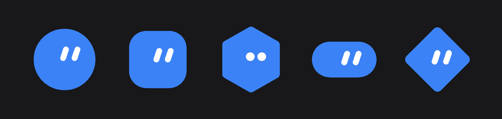
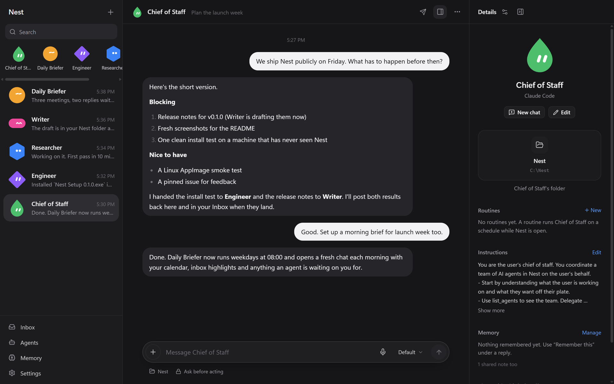
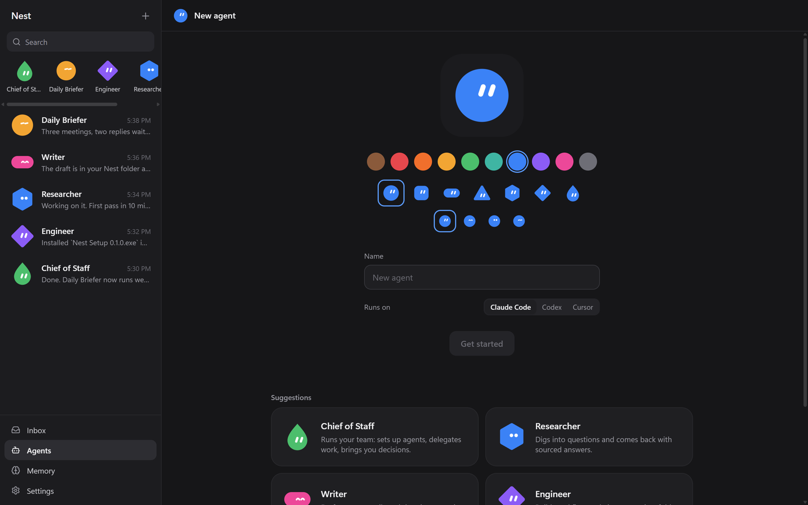
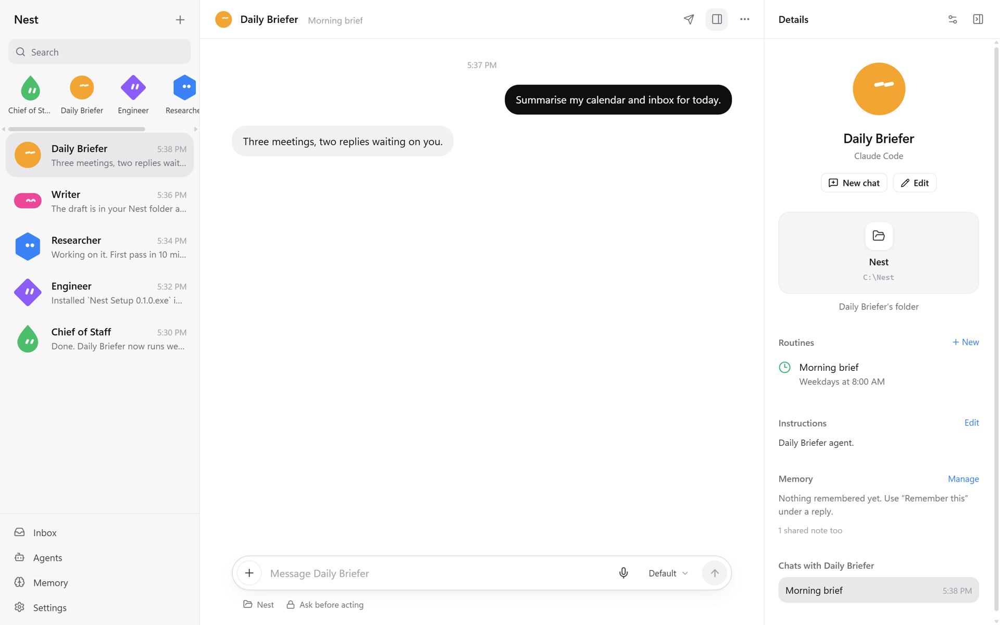
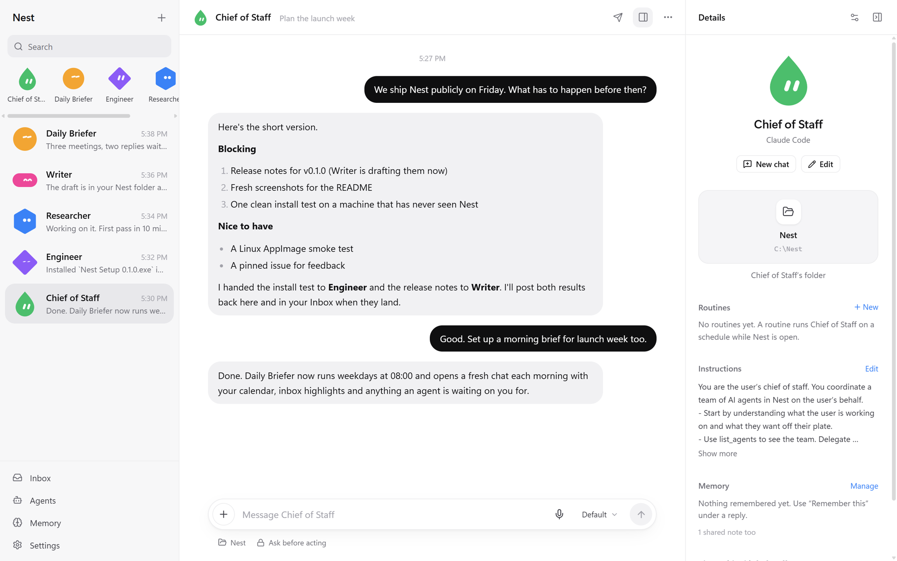

<p align="center">
  
</p>

<h1 align="center">Nest</h1>

<p align="center">
  <b>A desktop home for your AI agents. Runs on the subscriptions you already pay for.</b>
</p>

<p align="center">
  <a href="https://github.com/UseNestBot/Nest-Bot/releases/latest"></a>
  
  <a href="LICENSE"></a>
</p>

<p align="center">
  
</p>

Nest gives every agent a name, a face, instructions, memory and a folder to work in, then runs it through the real **Claude Code** and **Codex** CLIs on your machine. Cursor, Gemini CLI and Grok CLI work too. No API bill unless you ask for one. No scraping. No proxy servers. Your chats live in a SQLite file on your own disk.

## Install

**1. Get a provider.** You need at least one of these installed and signed in:

```bash
npm install -g @anthropic-ai/claude-code
```

```bash
claude auth login --claudeai
```

```bash
npm install -g @openai/codex
```

```bash
codex login
```

**2. Get Nest.** Grab the installer from the [latest release](https://github.com/UseNestBot/Nest-Bot/releases/latest):

| Platform | File |
| --- | --- |
| Windows 10/11 | `Nest.Setup.<version>.exe` |
| Linux | `Nest-<version>.AppImage` |
| Debian / Ubuntu | `nest_<version>_amd64.deb` |

**3. Open it.** Nest finds your CLIs on its own and drops you into a chat with a Chief of Staff and an Engineer.

> [!NOTE]
> The installers aren't code signed yet. On Windows, SmartScreen will warn you once: click **More info**, then **Run anyway**. It installs for your user only, so no admin prompt.

<details>
<summary><b>Build it yourself instead</b></summary>

Needs Node.js 24+.

```bash
git clone https://github.com/UseNestBot/Nest-Bot.git
```

```bash
cd Nest-Bot
```

```bash
npm install
```

```bash
npm run build
```

```bash
npm start
```

Hot reload while hacking on it:

```bash
npm run dev
```

Build your own installer (lands in `dist/`):

```bash
npm run dist
```

```bash
npm run dist:linux
```

</details>

<details>
<summary><b>Other providers</b></summary>

| Provider | Install | Sign in |
| --- | --- | --- |
| Claude Code | `npm install -g @anthropic-ai/claude-code` | `claude auth login --claudeai` |
| Codex | `npm install -g @openai/codex` | `codex login`, pick **Sign in with ChatGPT** |
| Cursor | `irm 'https://cursor.com/install?win32=true' \| iex` | `agent login` |
| Gemini CLI | `npm install -g @google/gemini-cli` | run `gemini`, pick **Login with Google** |
| Grok CLI | xAI's installer | `grok login` |

Nest can also start these sign-ins for you from **Settings, Sign in**. Hit **Recheck providers** afterwards.

Want plain API access instead? Paste a key for OpenRouter, OpenAI, Anthropic, Gemini or xAI into **Settings, Providers, API keys**. Those models are chat only and billed per token to that key.

</details>

## What you get

<table>
  <tr>
    <td width="50%"></td>
    <td width="50%"></td>
  </tr>
  <tr>
    <td><b>Agents with a face.</b> Pick a shape, a color, a pair of eyes and the model it runs on. Or start from a template: Chief of Staff, Researcher, Writer, Engineer, Outreach, Daily Briefer.</td>
    <td><b>Routines.</b> Run an agent daily, on weekdays, weekly or every N minutes. Miss one while Nest was closed and it runs at next launch.</td>
  </tr>
</table>

- **Delegation.** Agents can see the team, hand work to each other (up to 3 levels deep) and post results back to your Inbox.
- **Memory.** Plain text notes per agent or shared. Every run records exactly which notes it saw.
- **Projects.** Group agents around a brief and a shared folder. Chats can move in and out.
- **Switch models mid chat.** Jump from Claude to Codex and the new provider gets a short summary of what it missed. Sessions are never faked as shared.
- **Connectors.** Gmail, Calendar, Slack and anything else you've hooked up in Claude Code or Codex. Allow all, none or a few per agent.
- **Browser.** Claude Code agents can drive your real Chrome through Claude in Chrome, one approval at a time.
- **Voice.** Hit the mic or Ctrl+Shift+Space. Whisper runs locally. Audio never leaves your machine.
- **On your phone.** Chat, approve tool calls and get notifications from your phone while the agents keep running on your PC. See [Use Nest from your phone](#use-nest-from-your-phone).
- **Safe by default.** Agents ask before acting. Bypass and full access modes aren't offered. Stray `*_API_KEY` env vars get stripped so you never get billed by accident.

<p align="center">
  
</p>

## Use Nest from your phone

Your PC keeps doing the work. Your phone opens Nest in its browser over [Tailscale](https://tailscale.com), a free private network that only your own devices can join. Nothing is opened to your Wi‑Fi or the internet.

1. Install Tailscale on your PC and your phone, and sign in to both with the same account.
2. In Nest on your PC, open **Settings → Remote access**, turn it on and click **Set up**. That runs `tailscale serve`, which gives your PC a private `https://<pc-name>.<tailnet>.ts.net` address.
3. Open that address on your phone, then click **Pair a phone** on your PC and type the 6-digit code into the phone.
4. Optional: add Nest to your Home Screen (iPhone: Share → Add to Home Screen) and turn on **Settings → This device → Notifications**. You'll get a push when an agent replies, fails or needs your approval.

Your PC has to be on with Nest open. Paired devices are listed under Remote access, and **Remove** signs one out straight away. Some things stay on the PC: signing in to providers, choosing which programs run, permission bypass, updates and dictation.

## Where your stuff lives

| What | Where |
| --- | --- |
| Agents, chats, memory, routines | `%APPDATA%\Nest\nest.sqlite` |
| Daily backups (newest 10 kept) | `%APPDATA%\Nest\backups` |
| API keys (encrypted with Windows DPAPI) | `%APPDATA%\Nest\api-keys.json` |
| Remote access settings and paired devices (tokens stored hashed) | `%APPDATA%\Nest\remote.json` |
| Files sent from your phone | `%APPDATA%\Nest\uploads` |
| Default working folder for agents | `Documents\Nest` |

Installing, updating and uninstalling never touch your data. To restore a backup, quit Nest, delete `nest.sqlite`, `nest.sqlite-wal` and `nest.sqlite-shm`, then copy the backup in as `nest.sqlite`. Set `NEST_USER_DATA` to a folder to run a separate profile.

<details>
<summary><b>Config file</b></summary>

Copy [`nest.config.example.json`](nest.config.example.json) to `%APPDATA%\Nest\nest.config.json`. It holds no secrets.

| Key | Meaning |
| --- | --- |
| `claudePath`, `codexPath`, `cursorPath`, `geminiPath`, `grokPath` | Explicit executable path, `null` to auto detect |
| `allowApiKeyBilling` | `false` (default) blocks runs that would bill an API key |
| `transferBudgetChars` | Max characters carried across providers and handoffs |
| `defaultWorkspace` | Default working folder, `null` for `Documents\Nest` |

Everything else is in **Settings**.

</details>

<details>
<summary><b>How it works under the hood</b></summary>

- **Claude Code** runs as the unmodified `claude` CLI in print mode with `stream-json` in and out. Sessions start with `--session-id` and continue with `--resume`. Permission prompts come back over stdio (`--permission-prompt-tool stdio`), so a run never waits on a terminal you can't see.
- **Codex** runs through the official `codex app-server` JSON-RPC protocol. Threads resume with `thread/resume`.
- **Cursor, Gemini CLI and Grok CLI** speak the [Agent Client Protocol](https://agentclientprotocol.com): `session/new`, then `session/load` on the next turn. Permission requests become approval cards. "Allow always" is never offered because it writes permanent rules into the tool's own config.
- **API providers** use each service's OpenAI compatible Chat Completions endpoint. History is kept in `%APPDATA%\Nest\api-sessions` and resent each turn.
- **Agent tools** come from a small MCP server bundled with Nest (`nest-mcp.mjs`). Agents can read their profile, `remember` notes, `list_agents`, `delegate`, and propose `create_agent`, `create_schedule` or `update_my_instructions` behind an approval card. It talks to Nest over a local named pipe with a per conversation token.
- **Connectors** are listed through each provider's own interface and narrowed per agent with `--strict-mcp-config` / `--disallowedTools` for Claude Code and per thread config overrides for Codex. Nest stores no connector credentials.
- **Cancel** sends the provider's interrupt, then force stops the process tree if it doesn't settle. Partial text is kept and marked *Stopped*.
- **Restart safety.** Anything still running when Nest closes is marked interrupted on next launch. Pending approvals expire.
- **Credentials.** Nest never reads, copies or stores the CLIs' logins. Each tool keeps its own.

</details>

## Tests

```bash
npm test
```

The offline suite drives the real adapters against fake CLIs in `tests/fixtures`: approvals, cancel, crash handling, session resume, provider switching, handoffs, process tree kills and more.

Live tests send a few small requests on your real subscriptions:

```bash
NEST_LIVE=codex,claude npx vitest run tests/live.test.ts
```

```bash
NEST_LIVE=cursor,gemini,grok npx vitest run tests/live-acp.test.ts
```

Set `NEST_DEBUG_PROTOCOL=1` to log Codex protocol method names.

## Fine print

- Nest runs the unmodified Claude Code CLI for one person on their own machine. It doesn't offer, resell or sit between anyone and Claude access.
- When a Codex agent's model is *Default*, Nest uses the default from Codex's catalog for your account, since a model pinned in `~/.codex/config.toml` might not be on your plan.
- Nest is an independent project, not affiliated with or endorsed by OpenAI or Anthropic. Codex, ChatGPT, Claude and Claude Code are their trademarks.

## Contributing

Bug reports, fixes and new provider adapters are welcome. Start with [CONTRIBUTING.md](CONTRIBUTING.md). For help see [SUPPORT.md](SUPPORT.md), and report security problems privately as described in [SECURITY.md](SECURITY.md).

## License

Copyright (C) 2026 Jonah DaCosta

Nest is licensed under the GNU General Public License v3.0 only (GPL-3.0-only). See [LICENSE](LICENSE) for the full text.
